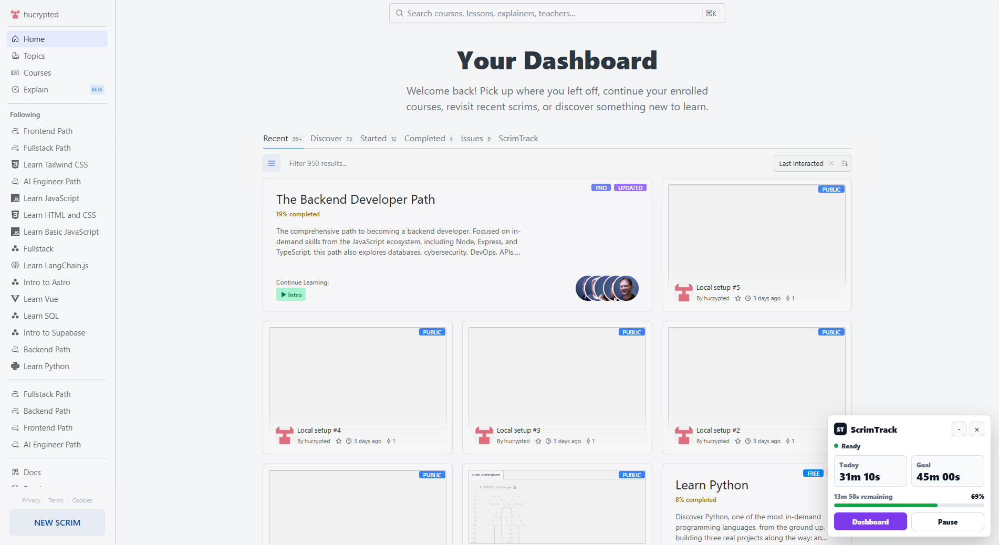
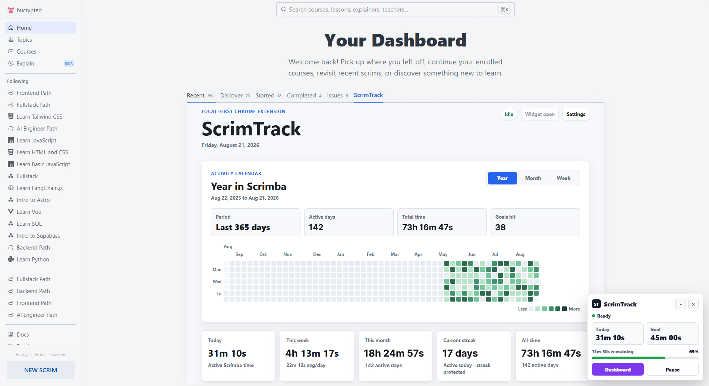
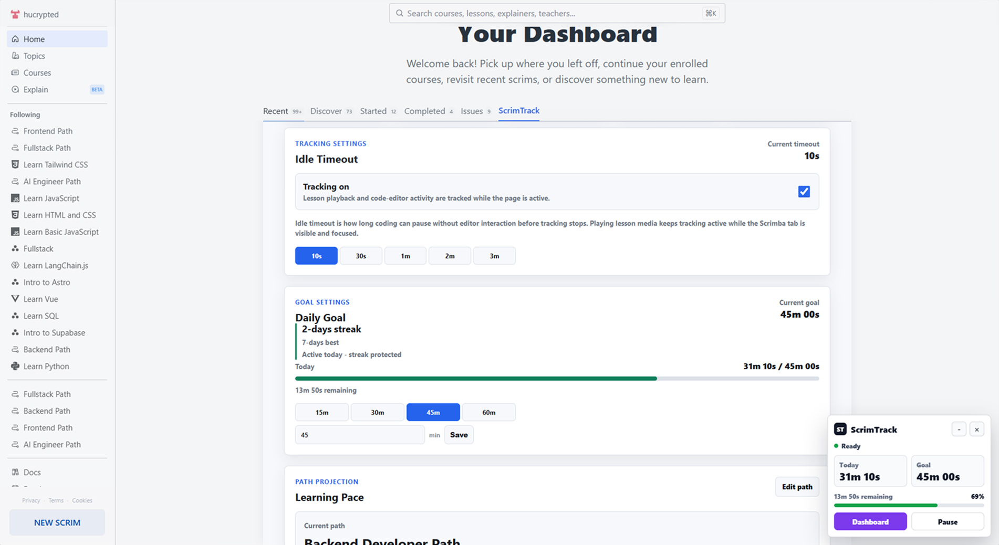
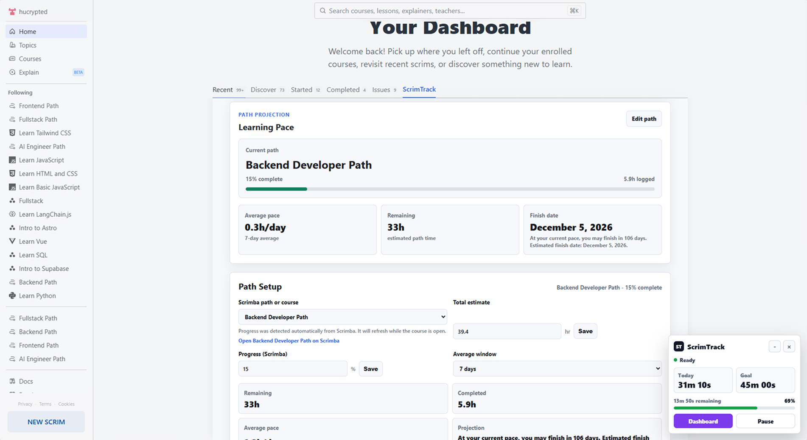
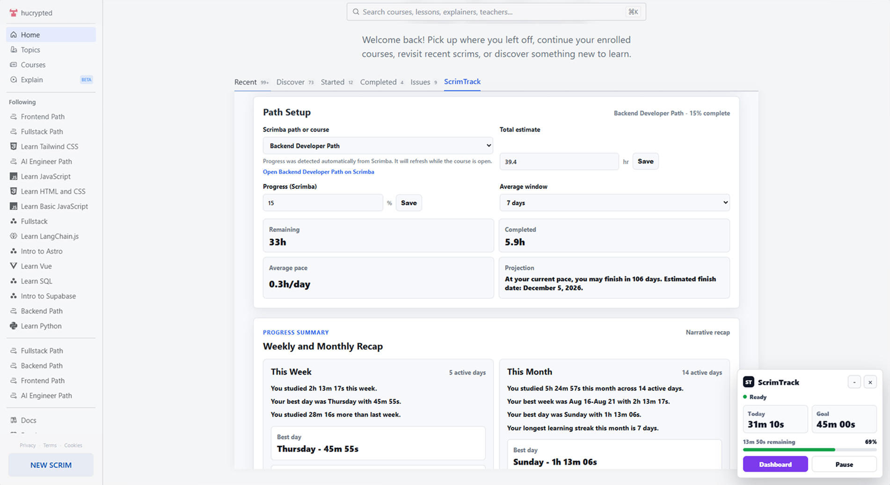
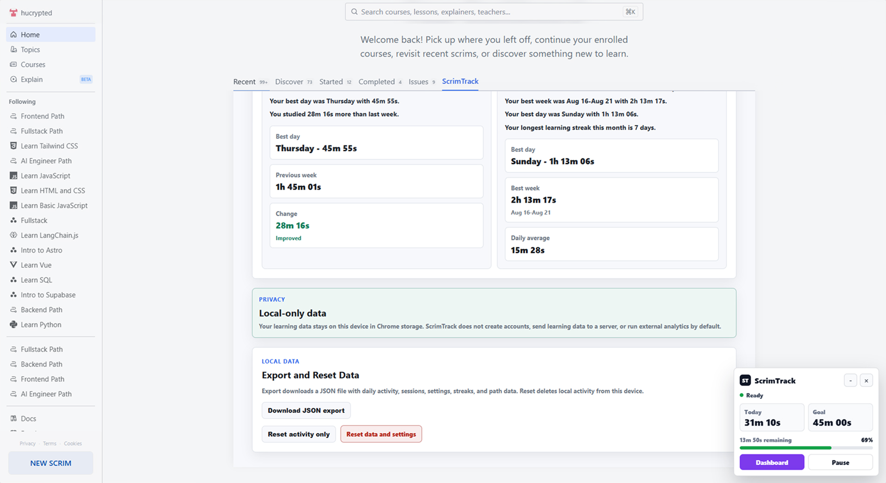

# ScrimTrack

ScrimTrack is an unofficial open-source Chrome extension for Scrimba learners who want a simple way to track focused learning time.

It tracks active Scrimba time, shows daily/weekly/monthly progress, builds streaks, displays a GitHub-style learning heatmap, and estimates your finish date based on your pace.

## Install

[](https://github.com/the-orbital-labs/scrimtrack/blob/main/LICENSE)

Install ScrimTrack from the Chrome Web Store:

[Add ScrimTrack to Chrome](https://chromewebstore.google.com/detail/scrimtrack/akjmadgnfokenilllgienlgedemaaidh)

See the [changelog](CHANGELOG.md) for release history and notable changes.

## What It Does

ScrimTrack helps you understand your Scrimba learning habits without accounts, syncing, or a backend server.

* Tracks active learning time only on supported Scrimba URLs
* Keeps tracking active while lesson media is playing in the visible, focused Scrimba tab
* Shows today, this week, this month, current streak, longest streak, and all-time totals
* Displays learning activity in a contribution-style heatmap
* Lets you set a daily learning goal
* Lets you select a Scrimba path or discovered course, sync visible progress,
  and estimate a finish date
* Exports and imports local data as JSON and supports local reset controls

## Screenshots

| Scrimba integration | Embedded activity dashboard |
| --- | --- |
|  |  |

| Tracking and daily goals | Path progress and projection |
| --- | --- |
|  |  |

| Path setup and progress recaps | Privacy and local data |
| --- | --- |
|  |  |

## Privacy

ScrimTrack is privacy-friendly by default.

* Learning data stays on your device in `chrome.storage.local`.
* ScrimTrack does not require accounts or authentication.
* ScrimTrack does not send learning data to a backend server.
* External analytics are not enabled by default.
* ScrimTrack only tracks activity on supported Scrimba URLs.

## Permissions

ScrimTrack requests limited permissions:

* `storage` is used to save activity, sessions, streaks, settings, selected
  courses, detected progress, and path projection data locally.
* Scrimba host access is limited to:

  * `https://scrimba.com/*`
  * `https://v2.scrimba.com/*`

ScrimTrack does **not** request access to:

* browsing history
* tabs
* bookmarks
* cookies
* `webRequest`
* `browsingData`
* `<all_urls>`

## Roadmap

ScrimTrack is built milestone by milestone, with a focus on simple local-first tracking for Scrimba learners.

Planned improvements include:

* Improve the embedded dashboard and floating tracker's usability
* Make daily goals, streaks, and progress summaries easier to understand
* Polish the contribution heatmap and finish-date projection experience
* Improve accessibility and extension UI consistency

ScrimTrack will stay local-first and focused on Scrimba learning. Backend services, accounts, AI features, and social features are not part of the roadmap.

## Feedback and Contributions

Feedback, bug reports, and focused contributions are welcome.

See [CONTRIBUTING.md](CONTRIBUTING.md) for the complete contribution workflow.
All project participation is governed by the
[Code of Conduct](CODE_OF_CONDUCT.md). Report suspected vulnerabilities
privately by following the [Security Policy](SECURITY.md).

Good issues or pull requests include:

* Bugs in Scrimba time tracking
* Incorrect daily, weekly, monthly, streak, or heatmap calculations
* UI or accessibility improvements
* Documentation fixes
* Small improvements that support the roadmap above

Before contributing:

* Keep the extension local-first.
* Track only `https://scrimba.com/*` and `https://v2.scrimba.com/*`.
* Keep Chrome permissions minimal.
* Avoid unrelated features, backend services, authentication, AI features, and social features.
* Run `npm run build` before opening a pull request.

## Local Development

To build and install ScrimTrack locally:

```bash
git clone https://github.com/the-orbital-labs/scrimtrack.git
cd scrimtrack
npm ci
npm run build
```

Then open `chrome://extensions` in Chrome, enable **Developer mode**, choose
**Load unpacked**, and select the generated `dist` directory.

Run `npm run build` again after making changes, then reload the extension from
`chrome://extensions`.

Storage mutations run in one queue in the background service worker. Register
new UI mutations with `defineStorageMutation` in `src/storageMutations.ts` and
import their module from the background worker so its handler is registered.
Keep each operation's reads and writes inside the mutation, and await every
write before it completes. Content scripts send mutation commands through
`chrome.runtime.sendMessage`. UI reads use the validated `getStorageValue` helper;
content scripts request validated reads from the worker to keep their classic
script bundle self-contained and wait for migration.

Storage and exports now use version 3. Before processing queued work on every
worker boot, the worker validates a complete snapshot and migrates unversioned
data and older additive formats in one write. Missing legacy settings/path
fields receive defaults; existing history dates and totals are preserved.
Malformed values and unsupported future versions fail visibly without being
overwritten. A failed migration can retry; its version advances only after the
whole snapshot is saved. Unknown local keys, such as widget position and pending
tracking entries, are left alone.

The dashboard and popup accept JSON exports up to 10 MB, including version 1
(`scrimba-learning-tracker`) and version 2 (`scrimtrack`) exports. Imports validate
dates, timezones, numeric ranges, session records, Scrimba URLs, and nested data
before showing a preview, then validate again in the worker before saving.
Malformed files, incomplete data, unsafe object keys, and future versions are
rejected. Export reads one snapshot through the same queue as mutations.

**Import replaces history, app settings, and path settings; it never merges.**
Download an export first to retain a backup, select a file, review the summary,
and choose **Replace local data with import** (or cancel without changing data).
Replacement commits in one write, so a failed save leaves existing data intact.
Re-importing the same file does not add its time twice. Goal completion and
streaks are recalculated, imported sessions become inactive, and current-page
state and tracking receipts are cleared under a fresh tracking generation.
Installation metadata and widget position stay with this device. Old pending
tracking messages cannot restore replaced history; fresh input starts tracking
again. Imported calendar dates retain their original meaning even when the
imported timezone differs from this device's timezone.

Tracking uses immutable `tracking-outbox:<session>:<sequence>` entries in local
storage. Each content script writes only its own entries, before requesting
delivery; the background worker owns shared totals, session receipts, and outbox
removal. This is the only exception to the shared-data single-writer rule.
The worker saves the receipt, daily/session totals, streak, and current-page
state in one storage operation before acknowledging an update. Retries keep the
same sequence and interval, and persisted receipts suppress duplicates after
lost replies or worker restarts. Receipts are retained until a data reset or import.

Pending entries replay when the worker starts or receives an outbox change.
Open pages retry interrupted requests with a three-second acknowledgement
timeout and exponential backoff capped at thirty seconds. The widget shows
“Saving delayed” while retrying and clears that status after recovery. A reset
commits a new tracking generation with the cleared totals; older queued updates
are discarded, and fresh input starts a session in the new generation.
Time that has not reached local storage cannot survive a browser crash or a tab
closing while storage is unavailable. Once an outbox entry is saved, the worker
can complete it without the originating tab.

### Module boundaries

`src/content.ts` coordinates page events and cleanup. Its `src/content/` modules
own session tracking (`tracker.ts`), playback detection (`playbackMonitor.ts`),
widget construction and behavior (`widget.ts`, `widgetController.ts`), embedded
dashboard DOM integration (`embeddedDashboard.ts`), and worker-backed storage
access (`storage.ts`). Delivery retries and worker persistence remain in
`trackingDelivery.ts` and `tracking.ts` respectively.

`src/dashboard/useDashboardData.ts` owns loading, periodic refresh, and storage
subscriptions for the dashboard. The activity calendar and progress recap render
in separate components; `App.tsx` composes them with settings and path controls.

Keep content-only runtime helpers out of the React/worker dependency graph.
Chrome injects `content.js` and `playback.js` as classic scripts; shared runtime
imports can cause Vite to emit module chunks that those entries cannot load.
Type-only imports are safe. Browser tests check that both built entries still
parse as classic scripts.

### Browser tests

```bash
npx playwright install chromium
npm run test:e2e
```

Playwright builds the extension before each suite, loads it into a fresh Chromium
profile per test, and waits for a queued page-to-worker mutation before seeding
storage. The startup version field alone is not a completion signal: it is written
concurrently with settings, path, and streak initialization. Test contexts use UTC;
calendar rendering tests explicitly choose their dates and saved timezones.

The suite uses locally fulfilled web pages, not live Scrimba. Time-counting tests
use real content-script timers, editor input, runtime messages, and persisted
daily/session totals. The six-second observation windows deliberately span a full
tracking pulse to verify that paused or inactive pages stop accumulating time.

Run `npx playwright test --repeat-each=3 --retries=0` to check stability without
retries hiding failures. Failed tests retain traces and browser logs in
`test-results/`; CI uploads those files as `browser-test-results`. Open a trace
with `npx playwright show-trace <path-to-trace.zip>`.

Add regression tests in the same change as each storage, tracking, or calendar
fix. Use unit tests for boundary cases and browser tests when the behavior crosses
content-script, worker, storage, or view boundaries. Do not defer coverage to a
separate testing milestone.

## Disclaimer

ScrimTrack is an unofficial project and is not affiliated with, endorsed by, or sponsored by Scrimba.

## License

ScrimTrack is released under the [MIT License](LICENSE).

### Calendar behavior

The saved timezone determines the current learning day, midnight splits, weekly
and monthly summaries, streaks, heatmaps, and finish estimates. Weeks start on
Sunday. Pace windows and finish estimates count calendar dates, including across
daylight saving changes. Open views refresh their calendar data every five seconds.
Changing timezone applies to future tracking and the current view; existing daily
history keeps its recorded dates and is not redistributed.
